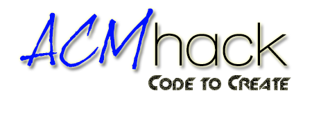
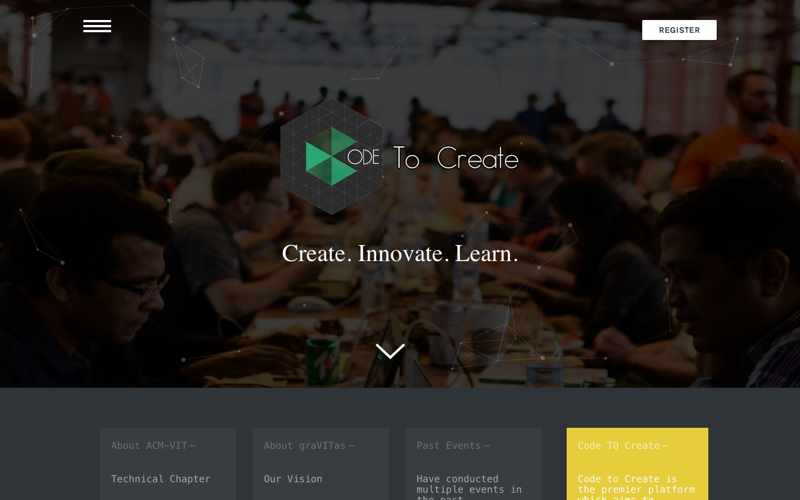
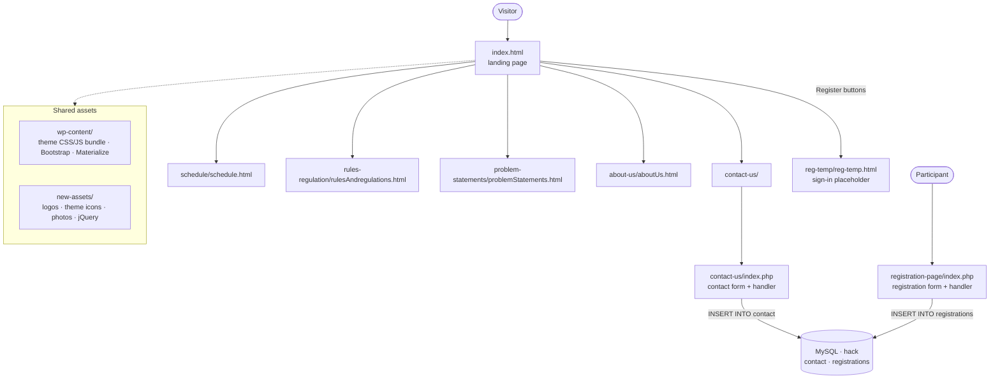

<p align="center"></p>

<p align="center"></p>

<p align="center">
  <a href="LICENSE"></a>
  
  
  <a href="https://github.com/abhinav-adtechs/Code-To-Create/commits/master"></a>
  <a href="https://github.com/abhinav-adtechs/Code-To-Create/stargazers"></a>
  <a href="https://c2c.acmvit.in/"></a>
  <a href="CONTRIBUTING.md"></a>
</p>

<p align="center"><b>The archived website of Code To Create, ACM-VIT's first-ever hackathon, held during graVITas 2015.</b></p>

<p align="center">
  <a href="#-features">Features</a> ·
  <a href="#-quick-start">Quick start</a> ·
  <a href="#-architecture">Architecture</a> ·
  <a href="#-docs">Docs</a> ·
  <a href="#-roadmap">Roadmap</a> ·
  <a href="#-contributing">Contributing</a>
</p>

<p align="center"></p>

> [!NOTE]
> **Status: archive.** This site was built between 2 and 16 August 2015 and hasn't changed since. It's kept as a snapshot of where ACM-VIT's hackathon started. The [c2c.acmvit.in](https://c2c.acmvit.in/) domain now serves a later edition of **Code2Create**, not this code.

## Why Code To Create?

In 2015, ACM-VIT (the ACM student chapter at VIT University, Vellore) ran its first hackathon as part of the graVITas 2015 tech fest. The event pitched itself as "the premier platform which aims to achieve solutions to everyday issues based on a set of themes through innovation, creativity and power of coding." It needed a home on the web: somewhere to pitch the themes, publish the schedule and rules, introduce the team, and take registrations. Three students built that site in two weeks, mixing hand-written pages with borrowed templates and a small PHP + MySQL back end.

## ✨ Features

<table>
  <tr>
    <td width="50%" valign="top">
      <h4>🏠 Landing page</h4>
      A <code>particles.js</code> hero ("Create. Innovate. Learn."), an intro to ACM-VIT and graVITas 2015, past events, the six hack themes, a quote carousel, sponsors and register buttons. See <code>index.html</code>.
    </td>
    <td width="50%" valign="top">
      <h4>🎯 Six themes</h4>
      Multimedia · Education · Healthcare · Social Welfare · Data Science · Internet of Things, each with its own icon from <code>new-assets/icon-list/</code>.
    </td>
  </tr>
  <tr>
    <td valign="top">
      <h4>🗓️ Schedule</h4>
      An animated vertical timeline that runs from commencement and pitching through the overnight hack to final pitches and prize distribution. See <code>schedule/schedule.html</code>.
    </td>
    <td valign="top">
      <h4>📜 Rules &amp; regulations</h4>
      Teams of two to four builders, everything made during the hack, open-source and third-party APIs allowed, a code review for top teams, and a code of conduct.
    </td>
  </tr>
  <tr>
    <td valign="top">
      <h4>👥 Team ACM-VIT</h4>
      The chapter's story (started in October 2009) and the 2015 core committee. See <code>about-us/aboutUs.html</code>.
    </td>
    <td valign="top">
      <h4>✉️ Reach Us</h4>
      The VIT campus address, a map link and a contact form. <code>contact-us/index.php</code> stores messages in a MySQL <code>contact</code> table.
    </td>
  </tr>
  <tr>
    <td valign="top">
      <h4>📝 Registration</h4>
      A Material Admin–styled form for registration number, email, phone, theme, abstract, tech skills and past projects. <code>registration-page/index.php</code> saves it with <code>mysqli</code>.
    </td>
    <td valign="top">
      <h4>🗄️ Database schema</h4>
      <code>db.sql</code> creates the <code>contact</code> and <code>registrations</code> tables in a <code>hack</code> database (a phpMyAdmin dump from MySQL 5.6).
    </td>
  </tr>
</table>

## 🧰 Tech stack

**Front end**
<br>


**Back end**
<br>


**Templates**
<br>


## 🏗 Architecture

A static multi-page site with two PHP endpoints. The content pages share the same header, nav and footer markup, and load the theme bundle from `wp-content/` plus images from `new-assets/`.



[`docs/ARCHITECTURE.md`](docs/ARCHITECTURE.md) covers each page, the registration and contact flows (with a sequence diagram), the data model, and a list of known issues.

## 🚀 Quick start

### Static pages

All you need is Python 3, or any static file server.

```bash
git clone https://github.com/abhinav-adtechs/Code-To-Create.git
cd Code-To-Create
python3 -m http.server 8000
```

Open <http://localhost:8000/>.

> [!TIP]
> The home page nav links point at folders (`schedule/`, `about-us/`, …), which a plain static server shows as directory listings. Open the pages directly instead:
>
> - `/schedule/schedule.html`
> - `/rules-regulation/rulesAndregulations.html`
> - `/problem-statements/problemStatements.html`
> - `/about-us/aboutUs.html`
> - `/contact-us/contactUs.html`

### PHP + MySQL pages (registration and contact)

The original 2015 instructions said to _"use XAMPP and create the database"_. That still works. If you'd rather use PHP's built-in server, you need PHP with the `mysqli` extension and a local MySQL:

```bash
mysql -u root -e "CREATE DATABASE IF NOT EXISTS hack"
mysql -u root hack < db.sql
php -S localhost:8000
```

Then open <http://localhost:8000/registration-page/> or <http://localhost:8000/contact-us/>.

> [!WARNING]
> The PHP handlers were written for PHP 5.5 and MySQL 5.6 (per the `db.sql` header). They build SQL by string concatenation, so run them only on your own machine and never expose them publicly. Hardening is on the [roadmap](#-roadmap).

## ⚙️ Configuration

There are no environment variables. Database settings are hard-coded at the top of each PHP handler:

| Variable      | Value in the code     | Where                                                 |
| ------------- | --------------------- | ----------------------------------------------------- |
| `$servername` | `localhost`           | `registration-page/index.php`, `contact-us/index.php` |
| `$username`   | `root`                | same                                                  |
| `$password`   | empty (XAMPP default) | same                                                  |
| `$dbname`     | `hack`                | same                                                  |

## 🗂 Project structure

```text
Code-To-Create/
├── index.html                      # landing page
├── about-us/aboutUs.html           # chapter story + 2015 core committee
├── schedule/
│   ├── schedule.html               # event timeline
│   ├── main.html                   # the vertical-timeline template it was built from
│   └── css/ js/ img/ scss/ partials/
├── rules-regulation/rulesAndregulations.html
├── problem-statements/problemStatements.html   # "will be updated soon" placeholder
├── contact-us/
│   ├── contactUs.html              # static contact page
│   └── index.php                   # contact page + PHP handler → `contact` table
├── reg-temp/reg-temp.html          # sign-in style placeholder
├── registration-page/
│   ├── index.php                   # registration form + PHP handler → `registrations` table
│   ├── hack.sql                    # earlier schema (registrations only)
│   ├── assets/                     # Material Admin / BoostBox template CSS + JS (~9 MB)
│   └── materialadmin/forms/        # template demo pages
├── homepage/index.html             # meta-refresh to the pre-2.2 homePage.html
├── db.sql                          # MySQL schema for the `hack` database
├── new-assets/                     # logos, theme icons, quote portraits, team photos, sponsor logos
└── wp-content/                     # mirrored WordPress theme bundle: minified CSS/JS, images (~8 MB)
```

## 📚 Docs

- [`docs/ARCHITECTURE.md`](docs/ARCHITECTURE.md): pages, assets, registration and contact flows, data model, known issues
- [`CHANGELOG.md`](CHANGELOG.md): the site's history from "Update 1.2" to the final August 2015 build
- [`CONTRIBUTING.md`](CONTRIBUTING.md): local setup, conventions and the PR checklist

## 🧭 Roadmap

The 2015 README listed two pending tasks: styling the registration form's inputs, and importing fonts through a font API. Both are folded into the list below.

- [ ] Save the participant's name on registration (the input has no `name` attribute)
- [ ] Use prepared statements and move DB settings out of the PHP source
- [ ] Point the static contact page's form at the local handler instead of a third-party URL
- [ ] Fix broken links and case-sensitive asset paths
- [ ] Finish the 2015 to-dos: load fonts through a font API and style the registration inputs
- [ ] Accessibility pass: `alt` text, form labels and colour contrast
- [ ] Prune unused template payload from `registration-page/assets` and `wp-content`
- [ ] Add screenshots of the 2015 site to this README

## 🤝 Contributing

This is an archive, but fixes that make it easier to run, browse or learn from are welcome. See [`CONTRIBUTING.md`](CONTRIBUTING.md).

## 🙌 Credits

- **[ACM-VIT](https://acmvit.in/)**, the ACM student chapter at VIT University, which organised Code To Create and whose 2015 core committee appears on the Team page.
- **Abhinav Das**: site structure, pages and most commits.
- **[Ashwini Purohit](https://github.com/ashwini0529)**: contact-form back end (#2), database schema (#3), home-page routing (#5) and an early résumé/abstract upload handler (#1).
- **[Rishi Raj](https://github.com/rishiraj824)**: registration-page fonts and styling (#6, later reverted in #7).

## 📄 License

[MIT](LICENSE) © 2015–2026 Abhinav Das

> [!IMPORTANT]
> The MIT license covers the original code in this repository. Bundled third-party material stays under its owners' terms. That includes:
>
> - the mirrored WordPress theme assets in `wp-content/`
> - the Material Admin and BoostBox template files in `registration-page/`
> - jQuery, Bootstrap, Materialize, Modernizr and the vertical-timeline template
> - web fonts, stock imagery, and the ACM, graVITas and sponsor logos

## Star history

<a href="https://star-history.com/#abhinav-adtechs/Code-To-Create&Date"></a>

---

<p align="center">Built by <a href="https://github.com/abhinav-adtechs">Abhinav Das</a> with ACM-VIT<br><sub>If this project helped you, consider giving it a ⭐</sub></p>
