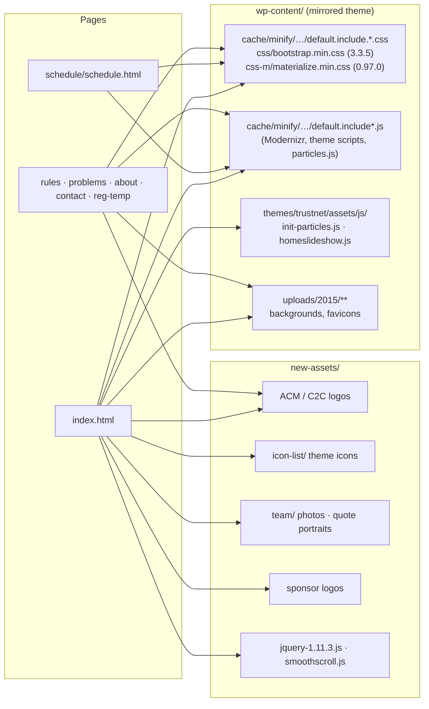
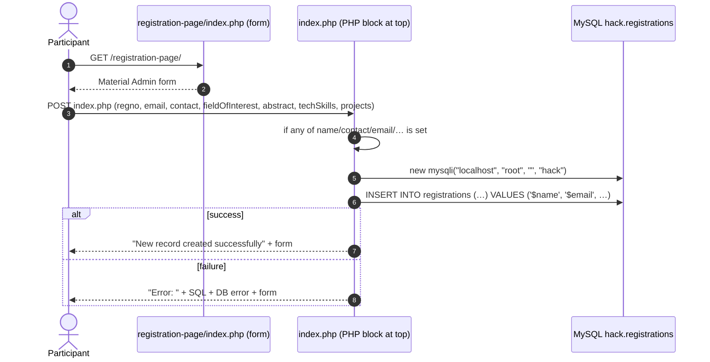
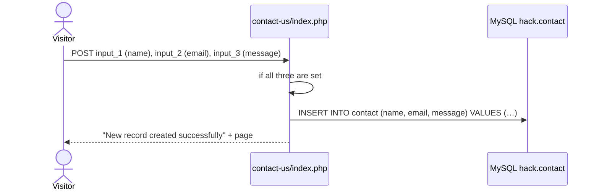
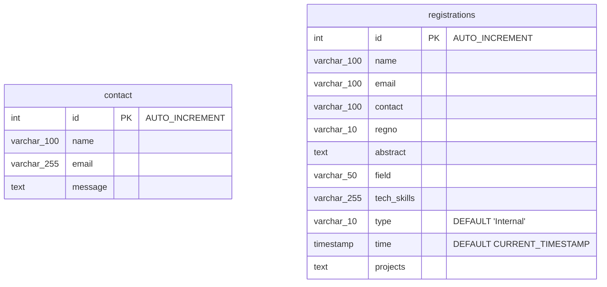

# Architecture

Code To Create is a 2015 multi-page website: hand-edited static HTML on top of borrowed template assets, plus two small PHP scripts that write to MySQL. This page maps every page and asset folder, explains the registration and contact flows, documents the data model, and lists the known issues of the archived build.

- [Page map](#page-map)
- [Shared layout and assets](#shared-layout-and-assets)
- [Registration flow](#registration-flow)
- [Contact flow](#contact-flow)
- [Data model](#data-model)
- [Routing history](#routing-history)
- [Known issues](#known-issues)

## Page map

| Path                                           | `<title>`                    | What's on it                                                                                                                                                                                                                                                                          |
| ---------------------------------------------- | ---------------------------- | ------------------------------------------------------------------------------------------------------------------------------------------------------------------------------------------------------------------------------------------------------------------------------------- |
| `index.html`                                   | ACM Code 2 Create            | Landing page: `particles.js` hero ("Create. Innovate. Learn."), "About ACM-VIT", "About graVITas" (graVITas 2015 theme "Design. Create. Patent."), past events, the Code To Create pitch, six theme tiles, a quote carousel, event sponsors, register calls to action, footer contact |
| `schedule/schedule.html`                       | Schedule                     | Vertical timeline: commencement and registration, introduction, pitching sessions, hack start, meals and breaks, night hack, mid-way pitch, final pitching, prize distribution                                                                                                        |
| `schedule/main.html`                           | Responsive Vertical Timeline | The unmodified timeline template the schedule page was built from (`cd-timeline` markup, `js/main.js`, `js/modernizr.js`, `scss/`)                                                                                                                                                    |
| `rules-regulation/rulesAndregulations.html`    | Rules & Regulations          | Team size (2–4), originality rule, APIs and open source allowed, ownership, no alcohol, code of conduct                                                                                                                                                                               |
| `problem-statements/problemStatements.html`    | Problem Statements           | Placeholder: "Problem Statements will be updated soon."                                                                                                                                                                                                                               |
| `about-us/aboutUs.html`                        | About Us - ACM VIT           | Who we are / what we believe / what we do, chapter history (started October 2009), 2015 core committee with photos from `new-assets/team/`                                                                                                                                            |
| `contact-us/contactUs.html`                    | Contact Us - ACM VIT         | VIT University address, GPS link to Google Maps, phone/email, contact form (see [known issues](#known-issues))                                                                                                                                                                        |
| `contact-us/index.php`                         | Contact Us - ACM VIT         | The same contact page with a PHP handler at the top that inserts into `contact`                                                                                                                                                                                                       |
| `reg-temp/reg-temp.html`                       | Registration Form            | A sign-in style placeholder (email, password, "Remember me"). The landing page's Register buttons point here                                                                                                                                                                          |
| `registration-page/index.php`                  | ACM-HACK REGISTRATION        | The real registration form plus a PHP handler that inserts into `registrations`                                                                                                                                                                                                       |
| `registration-page/materialadmin/forms/*.html` | (template)                   | Demo pages that came with the Material Admin template                                                                                                                                                                                                                                 |
| `homepage/index.html`                          | Page has moved               | `meta refresh` to `../homePage.html`, the landing page's name before Update 2.2                                                                                                                                                                                                       |

### The six themes

Multimedia · Education · Healthcare · Social Welfare · Data Science · Internet of Things. The icons are in `new-assets/icon-list/` (`multi1.png`, `education1.png`, `health1.png`, `social1.png`, `data1.png`, `iot1.png`).

## Shared layout and assets

- **Header and nav.** Every content page repeats the same menu: Home, Schedule, Rules and Regulation, Problem Statements, Team ACM-VIT and Reach Us. Sub-pages link with explicit file names (`../schedule/schedule.html`). The landing page links to folders (`schedule/`).
- **Footer.** Every content page has the chapter's contact line, email and a link to the ACM-VIT site.
- **Fonts.** The pages reference a Typekit script at a relative path (`../use.typekit.net/btn0pbu.js`) left over from mirroring, so it never loads. The 2015 README listed "fonts have to be imported using font-apis" as pending.
- **Template origin.** `wp-content/` holds the minified CSS/JS bundle and images of a mirrored WordPress theme (`wp-content/themes/trustnet`, plus Gravity Forms scripts for the contact form). `registration-page/assets/` holds the Material Admin and BoostBox admin templates (~9 MB, mostly unused demo modules).

## Registration flow

**Form fields → columns.** The handler reads `$_POST` keys and writes them straight into `registrations`:

| Form control               | `$_POST` key                  | Column        | Notes                                        |
| -------------------------- | ----------------------------- | ------------- | -------------------------------------------- |
| Username (`#username10`)   | _(none: input has no `name`)_ | `name`        | Always empty; see known issues               |
| Registration Number        | `regno`                       | `regno`       | `varchar(10)`                                |
| Email                      | `email`                       | `email`       | `type="email"`, required                     |
| Contact                    | `contact`                     | `contact`     | `maxlength="10"`, `data-rule-minlength="10"` |
| Field of interest (select) | `fieldOfInterest`             | `field`       | One of the six themes                        |
| Abstract                   | `abstract`                    | `abstract`    | textarea, required                           |
| Technical skills           | `techSkills`                  | `tech_skills` | textarea, required                           |
| Projects                   | `projects`                    | `projects`    | textarea, required                           |
| _(default)_                | —                             | `type`        | `'Internal'`                                 |
| _(default)_                | —                             | `time`        | `CURRENT_TIMESTAMP`                          |

An earlier version of the registration handler (PR #1) also uploaded an abstract and a tech-skills file to `uploads/abstract/` and `uploads/tech_skills/`. That code lived at `registration-form/hackathon-master/index.php` and isn't in the final tree.

## Contact flow

The handler only runs if the POST reaches `contact-us/index.php`. The form on that page posts to `contactUs.php`, which doesn't exist (see [known issues](#known-issues)).

## Data model

`db.sql` is a phpMyAdmin 4.2.7.1 dump (MySQL 5.6.20, PHP 5.5.15, generated 10 Aug 2015) for a database named `hack`. `registration-page/hack.sql` is an earlier dump that has only `registrations`.

Both tables are `ENGINE=InnoDB DEFAULT CHARSET=latin1`. They are independent, with no foreign keys.

## Routing history

The landing page went through three names, which explains the leftover redirect and the "proper routing" notes in the commits:

1. `temp.html`: the first main page (README at `dd65f41`)
2. `homePage.html`: Update 2.0 (`8d2a009`)
3. `index.html`: Update 2.2 (`4e0e8fa`), with `homepage/index.html` added as a redirect

PR #5 ("Proper routing done for Home page") switched the landing page's nav to folder URLs. Its commit message notes that the same rename to `index.html`/`index.php` still had to be done "in every page". That never happened, so the folder links only resolve for `contact-us/` (when PHP is serving).

## Known issues

These are documented as found; resolved items are marked below. Several are tracked in the README roadmap.

| #   | Issue                                                                                                                                                                                                    | Where                                                           |
| --- | -------------------------------------------------------------------------------------------------------------------------------------------------------------------------------------------------------- | --------------------------------------------------------------- |
| 1   | Name input has no `name` attribute, so `registrations.name` is always empty                                                                                                                              | `registration-page/index.php:100`                               |
| 2   | SQL built by string interpolation from `$_POST` (SQL injection); error branch echoes the query                                                                                                           | `registration-page/index.php:30`, `contact-us/index.php:23`     |
| 3   | DB credentials hard-coded (local `root`, empty password)                                                                                                                                                 | `registration-page/index.php:9-12`, `contact-us/index.php:7-10` |
| 4   | Static contact page's form `action` points at the third-party site the theme was mirrored from                                                                                                           | `contact-us/contactUs.html:95`                                  |
| 5   | PHP contact page's form posts to a non-existent `contactUs.php`                                                                                                                                          | `contact-us/index.php:119`                                      |
| 6   | Register buttons point to `../hackathon-master/reg-temp/…` (depends on the deploy folder name), and `reg-temp` is a sign-in placeholder; `registration-page/` isn't linked from anywhere                 | `index.html:58`, `index.html:503`                               |
| 7   | Landing-page nav links point to folders without an `index.html`                                                                                                                                          | `index.html:75-87`                                              |
| 8   | Fixed: the conference image and two logo references now use the exact filename case (`conference.JPG`, `splash_white.png`). The two logo references are in commented-out HTML. | `index.html:123`, `index.html:133`, `index.html:153`            |
| 9   | Missing scripts and leftovers from the mirror: `wb-content/try.js`, `/jquery-1.11.3.js`, `../use.typekit.net/…`, links to `badges.html`, `careers/`, `jobs/`, `news/`, `xmlrpc*.php`                     | `index.html` head and nav, sub-page heads                       |
| 10  | A background image uses an absolute `file:///C:/…` path from the original author's machine                                                                                                               | `index.html:340`                                                |
| 11  | Registration page loads a template script from an absolute `/assets/...` path                                                                                                                            | `registration-page/index.php:168`                               |
| 12  | The `isset` check for `abstract` has a line break inside the key                                                                                                                                         | `registration-page/index.php:6-7`                               |
| 13  | Only 6 of 22 `` tags on the landing page have `alt` text                                                                                                                                            | `index.html`                                                    |
| 14  | Schedule times are partly out of order (e.g. the breakfast break is listed as Sept 14 after Sept 15 entries)                                                                                             | `schedule/schedule.html`                                        |
